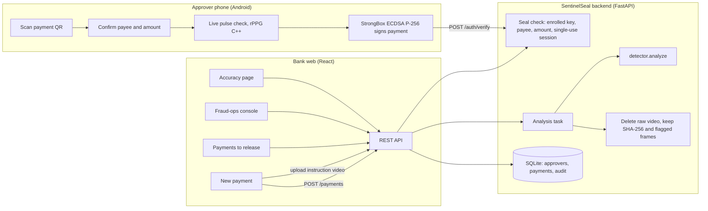

# SentinelSeal

**Banks check who is typing. SentinelSeal checks who decided.**

SentinelSeal is a verification layer for high-value corporate payments. Before a bank releases a large payment to a new payee, it checks that the company's designated approver really approved *that exact payment*, from his own enrolled phone. If the instruction arrived some other way (a WhatsApp message, a voice note, a video call), the payment is held, the instruction video is checked for deepfake manipulation, and the bank's fraud team gets plain-language evidence and a callback workflow.

Built for **RAKSHAM – AI Cybersecurity Hackathon** (IIT Delhi × Amazon), Track 3: *Deepfake Detection for Financial Communications*. Team **PenguinStack**.

---

## Contents

1. [The problem](#1-the-problem)
2. [How SentinelSeal works](#2-how-sentinelseal-works)
3. [Architecture](#3-architecture)
4. [Repository layout](#4-repository-layout)
5. [Quick start](#5-quick-start)
6. [Demo walkthrough](#6-demo-walkthrough)
7. [Reproducing our results](#7-reproducing-our-results)
8. [API reference](#8-api-reference)
9. [Safeguards as built](#9-safeguards-as-built)
10. [Known limitations](#10-known-limitations)
11. [Pre-existing work and finale work](#11-pre-existing-work-and-finale-work)
12. [Third-party models, data and licences](#12-third-party-models-data-and-licences)
13. [AI assistance](#13-ai-assistance)
14. [Team](#14-team)

---

## 1. The problem

A scammer impersonates a company director and gets an accounts employee to move money. In June 2026 a Mumbai company lost **₹10.4 crore over 63 transfers** after a WhatsApp message from an unknown number carrying the executive director's photo ([Business Today](https://businesstoday.in/latest/trends/story/63-transactions-rs10-crore-gone-how-a-fake-whatsapp-message-fooled-a-company-537698-2026-06-18)). In August 2026 Oriental Foundry, Mumbai, lost **₹1.98 crore** the same way ([Free Press Journal](https://www.freepressjournal.in/mumbai/mumbai-cyber-fraud-firm-duped-of-198-crore-in-whatsapp-director-impersonation-scam-fir-registered)). Deepfake video calls are the next step: they defeat the "call to confirm" habit that careful employees rely on.

The bank never sees the fake instruction. It sees an authorised employee, a correct login and a correct OTP. Maker-checker proves two employees agreed; nothing proves the decision-maker did.

## 2. How SentinelSeal works

For a payment to a **new payee at or above ₹5,00,000** (configurable), the bank requires one of two things:

| Path | What happens | Verdict |
|---|---|---|
| **Sealed approval** | The approver scans the payment QR on his enrolled phone, sees "Approve ₹48,00,000 to Vendor Pvt Ltd (A/c ••4417)?", passes a live-pulse check, and the phone's StrongBox key signs the payment ID, payee, amount and a single-use session. The server checks the signature **only against the key enrolled for that approver**. | `VERIFIED` → release |
| **Instruction check** | The maker uploads the instruction the payment is based on (video). The detector looks for manipulation and explains what it found. An unsigned instruction is **never** verified. | `SUSPICIOUS` (fraud team first) or `NEEDS_CALLBACK` |

Every held payment goes to the fraud-ops console: callback to the approver's **registered** number, then release (only after the approver confirms), or reject and report. Nothing is blocked automatically.

**Detection pipeline** (`detector/`): OpenCV frame sampling → MTCNN face crops → two pretrained deepfake classifiers (EfficientNet-B4, SigLIP) → POS rPPG pulse features from three face regions (Python port of our SentinelHard C++ engine) → fusion → verdict with plain-language reasons and flagged frames.

## 3. Architecture



| Component | Path | Built with |
|---|---|---|
| Approver app | `app/` | Kotlin, Jetpack Compose, CameraX, ML Kit QR, Android Keystore/StrongBox, C++/OpenCV rPPG |
| Backend | `backend/app/` | Python, FastAPI, SQLite, `cryptography` |
| Detector | `detector/` | PyTorch, facenet-pytorch (MTCNN), Hugging Face models, scikit-learn |
| Web screens | `src/` | React 18, Vite |
| Evaluation | `eval/evaluate.py` | runs `detector.analyze()` on labelled videos |

## 4. Repository layout

```text
sentinalseal/
├── app/                      Android approver app (SentinelHard base + SentinelSeal approval flow)
├── backend/
│   ├── app/
│   │   ├── routers/          auth (seal), payments, approvers, metrics, demo
│   │   └── services/         seal.py, payments.py, analysis.py, store.py, crypto.py, liveness.py
│   └── tests/                20 tests: seal attacks, bad inputs, end-to-end journey
├── detector/                 frames, faces, pulse, classifiers, features, fusion, reasons, analyze
│   ├── check_models.py       confirms the models load on this machine
│   └── tests/                33 unit tests
├── eval/
│   ├── evaluate.py           measured evaluation → results/
│   └── labels_template.csv   label file format
├── results/                  generated by eval/evaluate.py only
├── src/                      web screens (New payment, Payments to release, Fraud-ops, Accuracy)
├── CONTRACT.md               detector ↔ backend verdict format
├── FINALE.md                 feature log with commit references
└── RUNNING.md                short run guide for the demo laptop
```

## 5. Quick start

**Prerequisites:** Python 3.11–3.13 (tested on 3.13, Windows 11, CPU only), Node.js 18+, ffmpeg (only for robustness tests), Android Studio (for the phone app). Internet access on first run: the detector downloads its models from Hugging Face (several hundred MB, cached afterwards).

### 5.1 Backend

```bash
cd backend
pip install -r requirements.txt
pip install -r ../detector/requirements-py313.txt      # Python 3.13; use requirements.txt on older Python
pip install facenet-pytorch==2.6.0 --no-deps
cd ..
python -m detector.check_models                         # expect MTCNN OK and at least one deepfake model OK
cd backend
python -m uvicorn app.main:app --host 0.0.0.0 --port 8000
```

API docs: <http://localhost:8000/docs>. Runtime data lives in `backend/data/` (delete it to reset the demo).

### 5.2 Web screens

```bash
npm install
npm run dev -- --host
```

Open <http://localhost:5173>. The web app calls `<same host>:8000/api/v1`; to point it elsewhere, copy `.env.example` to `.env`.

### 5.3 Approver phone

1. Set `BASE_URL` in `app/src/main/java/com/example/sentinelhard/network/ApiClient.kt` to `http://<laptop-ip>:8000/api/v1/` (laptop and phone on the same Wi-Fi).
2. Build and install from Android Studio. A device with StrongBox (e.g. Pixel 7) is preferred; the app falls back to the TEE keystore otherwise.
3. Tap **Enrol this phone** once (registers the public key for approver `md-rakesh`).

## 6. Demo walkthrough

| # | Scenario | What you see |
|---|---|---|
| 1 | Genuine sealed approval | New payment → *Request sealed approval* → scan on phone → approve → **VERIFIED**, "Sealed by Rakesh M.'s enrolled phone" → Release |
| 2 | Deepfake instruction | New payment → *Upload the instruction you received* → **SUSPICIOUS** or **NEEDS CALLBACK** with reasons, flagged frames and "Raw video deleted at …" |
| 3 | Fraud response | Fraud-ops → evidence pack → *Approver denied* → Reject with note → Create report |
| 4 | Genuine user held by mistake | Upload a genuine video → held → *Approver confirmed* → Release → "cleared in m:ss" |
| 5 | Replay attack | New payment → *Demo tools* → replay last signature → **SUSPICIOUS**: "Signature was made for a different payment" |

The replay button is clearly marked DEMO ONLY and can be disabled with `DEMO_TOOLS=false`.

## 7. Reproducing our results

### 7.1 Automated tests

```bash
cd backend && python -m pytest tests -q          # 20 tests
cd .. && python -m pytest detector/tests -q      # 33 tests
```

| Suite | Covers |
|---|---|
| `backend/tests/test_seal.py` | genuine seal; attacker's own key sent with the request (ignored); unenrolled approver; changed amount; changed payee; wrong approver; replay onto another payment; same seal twice; tampered payload; stale timestamp; failed liveness lets the approver retry |
| `backend/tests/test_flow.py` | rule triggers only for new payee ≥ threshold; suspicious upload held and raw video deleted; unsigned clean video never verified; detector crash holds for callback; non-video refused; release needs a confirmed callback; reject + report + audit trail; suspicious first in queue; Accuracy endpoint never serves unmeasured numbers |
| `detector/tests/` | frame extraction, face detection, pulse maths, features, fusion, reasons, `analyze()` contract |

The backend tests replace the detector with a stub so they test the backend's rules, not detection accuracy. Accuracy is measured separately (7.2).

### 7.2 Detector evaluation

1. **Get test videos.** We use public, consented data only:
   - [DeepSpeak v1](https://arxiv.org/abs/2408.05366) (UC Berkeley): consented participants talking to a webcam; face-swap and lip-sync fakes. Research and non-commercial use.
   - DFDC training sample (Kaggle): a second source for cross-dataset checks.
   - Team recordings: genuine videos of team members, recorded with written consent, kept out of the repository.
   - **Not Celeb-DF**: the EfficientNet-B4 checkpoint was trained on it, so results there would be inflated.
2. **List them** in a CSV following `eval/labels_template.csv` (`path,label,fake_type,source`; label 0 = genuine, 1 = fake). Commit the CSV (file names and labels only, never the videos).
3. **Run:**
   ```bash
   python -m detector.check_models
   python eval/evaluate.py --labels eval/labels.csv --robustness --seed 42
   ```
4. **Outputs** in `results/`: `metrics.json` (marked `"provenance": "measured"`), `misses.json`, `per_file.csv`, `REPORT.md`. The app's Accuracy page reads `metrics.json` and refuses to show any file not marked as measured.

**What is measured.** A video counts as *flagged fake* when the verdict is `SUSPICIOUS`. FPR is the share of genuine videos flagged; FNR the share of fakes not flagged. Also reported: balanced accuracy with a 1,000-sample bootstrap 95% interval, AUC from the fused score, results per fake type and per source, latency per video, and (with `--robustness`) the same metrics after ffmpeg re-encoding: WhatsApp-like bitrate, 360p, darker, blur, 15 fps.

**Determinism.** Inference runs on CPU in evaluation mode. `--seed` fixes the bootstrap. Model weights are the published checkpoints named in section 12, fetched by name from Hugging Face.

### 7.3 Status of results

The evaluation script above runs the real detector. An earlier script (`eval/run_all.py`) produced numbers from random draws rather than detector runs; those numbers were removed on 25 October 2026 and must not be quoted. Until `results/metrics.json` is regenerated by `eval/evaluate.py`, the Accuracy page shows "Not measured yet".

## 8. API reference

All paths are under `/api/v1`. Interactive docs at `/docs`.

| Method | Path | Purpose |
|---|---|---|
| GET | `/approvers` | designated approvers (enrolled first) |
| POST | `/enrol` | register an approver phone's public key |
| POST | `/payments` | create a payment; returns whether a check is required and a QR session |
| GET | `/payments`, `/payments?status=held` | list payments; held queue (suspicious first) |
| GET | `/payments/{id}` | full record: verdict, reasons, thumbnails, timers, callback, audit |
| POST | `/payments/{id}/approval-session` | new QR session |
| POST | `/payments/{id}/instruction` | upload instruction video → detector → hold |
| GET | `/payments/{id}/frames/{n}` | flagged-frame thumbnail |
| POST | `/payments/{id}/callback` | `{"outcome": "confirmed" \| "denied"}` |
| POST | `/payments/{id}/release` | release (held payments need a confirmed callback) |
| POST | `/payments/{id}/reject` | reject with a note |
| POST | `/payments/{id}/report` | fraud report for a rejected payment |
| POST | `/auth/verify` | sealed approval from the phone |
| GET | `/metrics`, `/metrics/misses` | measured results only |
| POST | `/demo/replay` | DEMO ONLY: resend the last accepted seal against another payment |

The verdict format is defined in [`CONTRACT.md`](CONTRACT.md).

## 9. Safeguards as built

- **Enrolled keys only.** `/auth/verify` ignores any public key in the request; the signature must verify against the key enrolled for the named approver.
- **Bound to one payment.** The signature covers payment ID, payee, amount and a single-use, 5-minute session; reuse, edits and replays are refused and the target payment is held.
- **Unsigned is never verified.** Detection can raise or lower the alarm, never approve.
- **No automatic blocking.** Held payments are reviewed by a person; release needs a confirmed callback to the registered number.
- **Plain-language reasons.** Every alert lists which signals fired; the score is shown only to the fraud team, with its scale.
- **Raw video deleted after analysis.** Only the SHA-256 fingerprint and up to four flagged-frame thumbnails are kept. The screen shows when the video was deleted.
- **Honest failure.** If the deepfake models cannot load, the result says the video was not checked; it does not produce a score.
- **Audit trail** of every action with time and actor.

## 10. Known limitations

- **Pulse features are not yet validated.** On a genuine 5.6 s phone video the estimated heart rate ranged from 58 to 82 BPM across compression levels and the forehead–cheek pulse agreement stayed below 0.35. Treat the pulse features as experimental until `eval/evaluate.py` shows they help.
- **Screen-replay check is disabled.** It flagged genuine phone videos (green–red correlation 0.99) and stays off until validated.
- **Lip-sync fakes** change only the mouth and are the hardest case for face-swap classifiers.
- **Short clips** (under about 8 s) give unstable pulse estimates; clips under 2 s are held for callback without analysis.
- **Live calls are not analysed.** The detector checks recordings and forwarded clips; the hold-and-callback rule covers what it cannot see.
- **Not yet built:** server-side verification of the Android attestation chain, Play Integrity, persistent session store (sessions are in memory; payments and keys are in SQLite), spoken-code challenge.
- **Approver coercion** (the real approver tricked into sealing) is out of scope; existing bank controls apply.

## 11. Pre-existing work and finale work

Everything up to tag **`pre-finale`** (commit `49c0418`) is our earlier project **SentinelHard** (IOB CyberNova 2026): Android StrongBox signing, the C++ rPPG engine, and a FastAPI/React login flow. It was declared on the Round 1 submission and the Pre-Event Disclosure Form.

```bash
git diff --stat pre-finale..HEAD     # all finale work
git log --oneline pre-finale..HEAD
```

## 12. Third-party models, data and licences

| Item | Source | Use | Licence / terms |
|---|---|---|---|
| EfficientNet-B4 deepfake classifier | [honi05/deepfake-detection](https://huggingface.co/honi05/deepfake-detection) | frame classifier | MIT |
| SigLIP deepfake classifier | [prithivMLmods/Deep-Fake-Detector-Model](https://huggingface.co/prithivMLmods/Deep-Fake-Detector-Model) | frame classifier | Apache-2.0 |
| MTCNN | [facenet-pytorch](https://github.com/timesler/facenet-pytorch) | face detection | MIT |
| DeepSpeak v1 | [UC Berkeley](https://arxiv.org/abs/2408.05366) | evaluation only | research, non-commercial |
| DFDC sample | Kaggle | evaluation only | competition terms |
| Android Keystore / StrongBox | Google | key generation and signing | Android SDK terms |

No bank, customer or platform data is used. Synthetic payment records only.

## 13. AI assistance

AI coding assistants (Anthropic Claude, Google Antigravity) were used to help write and review parts of this repository, as declared on the Pre-Event Disclosure Form. All code was reviewed and run by the team. See [`FINALE.md`](FINALE.md).

## 14. Team

**PenguinStack**, B.S. Abdur Rahman Crescent Institute of Science and Technology

| Member | Finale role |
|---|---|
| Prajit | backend, seal verification, web screens, approver app |
| Shoaib | detector pipeline, evaluation |
| Natasha P A | documentation, testing, demo |
